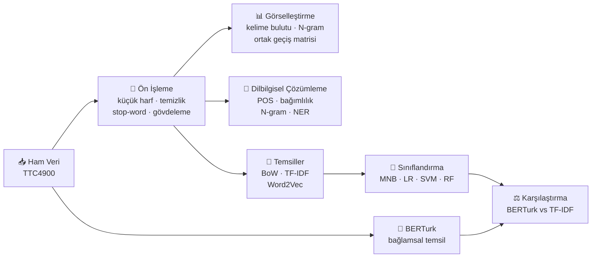

<div align="center">

# 📰 Türkçe Haber Metni Sınıflandırma

### Türkçe Haber Metinleri Üzerinde Uçtan Uca Bir NLP Hattı

*Ham metinden BERTurk'e: ön işleme, dilbilgisel çözümleme, metin temsilleri ve sınıflandırma*

<br>

[](https://www.python.org/)
[](https://jupyter.org/)
[](https://colab.research.google.com/github/KULLANICI_ADI/REPO_ADI/blob/main/Turkce_Haber_Siniflandirma.ipynb)
[](https://huggingface.co/datasets/savasy/ttc4900)

[](https://scikit-learn.org/)
[](https://pytorch.org/)
[](https://huggingface.co/dbmdz/bert-base-turkish-cased)
[](https://stanfordnlp.github.io/stanza/)
[](https://radimrehurek.com/gensim/)
[](https://www.nltk.org/)
[](https://creativecommons.org/publicdomain/zero/1.0/)

<br>

| 🏆 En iyi model | 🎯 Macro-F1 | ✅ Accuracy | 🤖 BERTurk (1K alt küme) | ⏱️ Toplam süre |
|:---:|:---:|:---:|:---:|:---:|
| **TF-IDF + Doğrusal SVM** | **0,914** | **0,912** | **0,882** macro-F1 | **18,7 dk** (Colab CPU) |

</div>

---

## 📑 İçindekiler

- [Proje Hakkında](#-proje-hakkında)
- [Veri Seti](#-veri-seti)
- [NLP Hattı](#-nlp-hattı)
- [Bölümler](#-bölümler)
- [Sonuçlar](#-sonuçlar)
- [Öne Çıkan Bulgular](#-öne-çıkan-bulgular)
- [Kurulum ve Çalıştırma](#-kurulum-ve-çalıştırma)
- [Kullanılan Teknolojiler](#-kullanılan-teknolojiler)
- [Kaynaklar](#-kaynaklar)

---

## 🎯 Proje Hakkında

Bu proje, **BİL482 Doğal Dil İşleme** dersi kapsamında hazırlanmış bir uygulama ödevidir. Amaç, bir Türkçe haber metnini **yedi konu kategorisinden** birine atayan çok sınıflı bir metin sınıflandırma sistemi geliştirmektir.

Çalışma yalnızca bir sınıflandırıcı eğitmekle kalmaz; ham metinden başlayarak **uçtan uca bir NLP hattı** kurar:

- 🧹 Türkçeye özgü ön işleme (I/İ dönüşümü, kopuk ek temizliği, gövdeleme)
- 🔬 Dilbilgisel çözümleme (POS, bağımlılık ayrıştırma, N-gram, NER)
- 🔢 Klasik ve yoğun temsiller (BoW, TF-IDF, Word2Vec)
- 🤖 Önceden eğitilmiş Transformer modeli (BERTurk) ile bağlamsal temsiller
- 📊 8 deneylik karşılaştırmalı sınıflandırma ve hata analizi

> 💡 **Not:** Veri seti küçük harfli, noktalamasız ve kesme işaretiyle ayrılan ekleri kopuk bir yapıdadır. Hattın her adımı bu özelliklere göre uyarlanmış ve bu yapının NLP araçlarının başarısına etkisi ayrıca incelenmiştir.

---

## 📚 Veri Seti

| Özellik | Değer |
|---|---|
| **Ad** | TTC4900 — *A Benchmark Data for Turkish Text Categorization* |
| **Kaynak** | [`savasy/ttc4900`](https://huggingface.co/datasets/savasy/ttc4900) (Hugging Face) · [Yedek CSV](https://raw.githubusercontent.com/savasy/TurkishTextClassification/master/7allV03.csv) |
| **Lisans** | CC0: Public Domain |
| **Ham boyut** | 4.900 haber × 2 sütun (`metin`, `kategori`) |
| **Temizlik sonrası** | **4.539 haber** (361 tekrarlanan haber veri sızıntısını önlemek için çıkarıldı) |
| **Ortalama uzunluk** | 269,5 kelime (sağa çarpık dağılım) |

### 🏷️ Kategori Dağılımı

| Kategori | Kayıt | Oran |
|---|:---:|:---:|
| 🏛️ Siyaset | 690 | %15,20 |
| 💰 Ekonomi | 690 | %15,20 |
| 🌍 Dünya | 677 | %14,92 |
| 💻 Teknoloji | 647 | %14,25 |
| ⚽ Spor | 636 | %14,01 |
| 🏥 Sağlık | 632 | %13,92 |
| 🎭 Kültür | 567 | %12,49 |

En büyük / en küçük sınıf oranı **1,22** olduğundan ciddi bir dengesizlik yoktur; yine de karşılaştırmalarda **macro-F1** esas alınmıştır.

---

## 🔄 NLP Hattı



---

## 🧩 Bölümler

<details>
<summary><b>G1 · Veri Yükleme ve Keşifsel Analiz</b></summary>

<br>

- Hugging Face üzerinden yükleme, erişim sorununda özgün GitHub CSV'sine otomatik geçiş
- Eksik, boş ve tekrarlanan metinlerin tespiti ve temizliği
- Sınıf dağılımı ve metin uzunluğu analizi (tablo + grafik)

</details>

<details>
<summary><b>G2 · Metin Ön İşleme</b></summary>

<br>

| Adım | Açıklama |
|---|---|
| **Türkçe küçük harf** | `str.lower()` `I→i` ve `İ→i̇` (2 karakter) hatası yapar; özel fonksiyon `I→ı`, `İ→i` dönüşümünü doğru uygular |
| **Temizlik** | URL, e-posta, sayı, noktalama, Windows-1252 kalıntıları silinir; şapkalı harfler sadeleştirilir |
| **Tokenization** | NLTK `punkt` noktalamasız metinde tek cümle döndürdüğü için **yüklem tabanlı sözde cümle bölücü** geliştirildi (3.981 cümlelik havuz) |
| **Stop-word** | NLTK (53) + kopuk ekler + haber dili kalıpları = **180 kelime**; ayırt edici `yüzde`, `milyon`, `dr` gibi kelimeler bilerek korundu |
| **Gövdeleme** | Snowball ile Stanza lemmatizasyonu 15 kelimede karşılaştırıldı; hız farkı (1,4 sn vs 83,5 sn) nedeniyle Snowball seçildi |
| **`on_isle()`** | Tüm adımlar tek fonksiyonda birleştirildi; ortalama kelime sayısı 269,5 → 194,2 |

</details>

<details>
<summary><b>G3 · Metin Görselleştirme</b></summary>

<br>

- Ön işleme öncesi/sonrası kelime bulutları
- Her kategori için en sık 15 unigram ve 10 bigram
- En sık 10 kelime için pencere boyutu 5 olan ortak geçiş matrisi

</details>

<details>
<summary><b>G4 · Dilbilgisel Çözümleme</b></summary>

<br>

- **POS:** 50 rastgele cümlenin Stanza ile etiketlenmesi ve kategoriler arası karşılaştırma
- **Bağımlılık:** 3 cümlenin özne–nesne–yüklem ilişkileri üzerinden yorumlanması
- **N-gram:** Sıfır olasılık sorunu ve Laplace düzleştirmesinin sayısal etkisi
- **NER:** 150 haberde 424 varlık (ORG, PER, LOC, TIME, MONEY) ve Türkçeye özgü hata analizi

</details>

<details>
<summary><b>G5 · Metin Temsilleri</b></summary>

<br>

- BoW ve TF-IDF matrisleri: **4.539 × 27.886**, **%99,57 seyrek**
- IDF değerinin elle hesaplanıp `TfidfVectorizer` ile doğrulanması (`maç` → 3,354574 ✔️)
- Veri üzerinde **Word2Vec (Skip-gram)** eğitimi, en yakın komşular ve kosinüs benzerliği ısı haritası

</details>

<details>
<summary><b>G6 · Metin Sınıflandırma ve Değerlendirme</b></summary>

<br>

- %80 / %20 tabakalı bölünme (3.631 eğitim, 908 test); vektörleştiriciler yalnızca eğitim kümesinde eğitildi
- 4 model × 2 temsil = **8 deney**
- En iyi model için sınıflandırma raporu, karışıklık matrisi ve yanlış sınıflandırılan örnekler üzerinden hata analizi

</details>

<details>
<summary><b>G7 · Transformer: BERTurk</b></summary>

<br>

- [`dbmdz/bert-base-turkish-cased`](https://huggingface.co/dbmdz/bert-base-turkish-cased) yalnızca **özellik çıkarıcı** olarak kullanıldı (ince ayar yok)
- WordPiece tokenization analizi (`gözlükçülerimizden → gözlük + ##çü + ##lerimizden`)
- Çok anlamlı **"yüz"** kelimesinin bağlama göre değişen vektörleri
- Dikkat ağırlıklarının ısı haritalarıyla görselleştirilmesi
- 1.000 kayıtlık alt kümede BERTurk ve TF-IDF karşılaştırması

</details>

---

## 📊 Sonuçlar

### 🧪 Klasik Modeller (Tüm Veri · 908 Test Örneği)

| # | Temsil | Model | Accuracy | Precision | Recall | **F1 (macro)** | Süre (sn) |
|:---:|:---:|---|:---:|:---:|:---:|:---:|:---:|
| 🥇 | TF-IDF | **Doğrusal SVM** | 0,9119 | 0,9134 | 0,9138 | **0,9135** | 0,31 |
| 🥈 | TF-IDF | Lojistik Regresyon | 0,9097 | 0,9122 | 0,9109 | **0,9114** | 5,11 |
| 🥉 | TF-IDF | Multinomial NB | 0,8888 | 0,8943 | 0,8892 | **0,8906** | 0,06 |
| 4 | BoW | Multinomial NB | 0,8888 | 0,8923 | 0,8901 | 0,8901 | 0,04 |
| 5 | BoW | Lojistik Regresyon | 0,8789 | 0,8823 | 0,8796 | 0,8804 | 3,72 |
| 6 | BoW | Random Forest | 0,8778 | 0,8795 | 0,8796 | 0,8792 | 19,02 |
| 7 | TF-IDF | Random Forest | 0,8678 | 0,8693 | 0,8699 | 0,8692 | 18,21 |
| 8 | BoW | Doğrusal SVM | 0,8667 | 0,8691 | 0,8678 | 0,8675 | 1,57 |

### 🏷️ En İyi Modelin Sınıf Bazında Başarısı (TF-IDF + Doğrusal SVM)

| Kategori | Precision | Recall | F1 |
|---|:---:|:---:|:---:|
| ⚽ Spor | 0,992 | 0,984 | **0,988** |
| 🏥 Sağlık | 0,952 | 0,944 | 0,948 |
| 🎭 Kültür | 0,930 | 0,938 | 0,934 |
| 💻 Teknoloji | 0,890 | 0,931 | 0,910 |
| 🏛️ Siyaset | 0,894 | 0,913 | 0,903 |
| 💰 Ekonomi | 0,867 | 0,848 | 0,857 |
| 🌍 Dünya | 0,870 | 0,838 | 0,854 |

### 🤖 BERTurk vs TF-IDF (1.000 Kayıtlık Alt Küme · 200 Test Örneği)

| Yaklaşım | Accuracy | **F1 (macro)** |
|---|:---:|:---:|
| TF-IDF + Doğrusal SVM | 0,845 | 0,846 |
| **BERTurk (mean pooling) + Lojistik Regresyon** | **0,880** | **0,882** ⬆️ +3,6 puan |

---

## 💡 Öne Çıkan Bulgular

> **📈 TF-IDF, doğrusal modellerde BoW'dan açıkça üstün.** Doğrusal SVM'de macro-F1 0,868'den 0,914'e çıkmıştır. IDF her sınıfta geçen kelimeleri bastırırken `sublinear_tf` ve L2 normalizasyonu uzun haberlerin baskınlığını azaltır.

> **🐢 Random Forest hem en zayıf hem en yavaş model.** 24 bin boyutlu seyrek uzayda ağaçlar her bölmede az sayıda özelliğe baktığı için doğrusal modeller kadar verimli değildir (~19 sn vs 0,3 sn).

> **🔀 Hataların büyük kısmı etiket belirsizliğinden kaynaklanıyor.** En çok karışan çiftler *ekonomi ↔ dünya* ve *dünya → siyaset*'tir. Örneğin solucan gübresi tesisi haberi (teknoloji) `lira` ve `üret` kelimeleri nedeniyle ekonomi olarak tahmin edilmiştir.

> **🤖 BERTurk az veriyle daha güçlü.** İnce ayar yapılmadan, yalnızca ilk 128 token görülerek ve küçük harfli/noktalamasız veriye rağmen BERTurk temsilleri TF-IDF'i geride bırakmıştır. Bedeli hesaplama maliyetidir: 1.000 metnin temsili CPU'da ~10 dakika sürmüştür.

> **🔤 Büyük harf ve noktalama kaybı NLP araçlarını zorluyor.** Küçük harfli özel adlar POS'ta ADJ/NOUN olarak etiketlenmiş, NER varlıkları kaçırmış, BERTurk ise `fransa` gibi adları alt parçalara bölmüştür.

> **🧠 Bağlamsal vs statik temsil.** BERTurk'te "yüz" kelimesinin aynı anlamdaki kullanımları arasındaki benzerlik **0,880**, farklı anlamdakilerle **0,418–0,657**'dir. Word2Vec ise tüm anlamları tek bir vektörde karıştırır.

---

## 🚀 Kurulum ve Çalıştırma

### ☁️ Google Colab (Önerilen)

1. Yukarıdaki **Open in Colab** rozetine tıklayın veya `.ipynb` dosyasını Colab'a yükleyin.
2. `Çalışma zamanı → Tümünü çalıştır` seçeneğiyle defteri baştan sona çalıştırın.

> ⏱️ Defterin tamamı varsayılan **Colab CPU** çalışma zamanında yaklaşık **18,7 dakikada** çalışır. Sürenin yarısından fazlası G7'deki BERTurk temsil çıkarımına aittir.

### 💻 Yerel Ortam

```bash
# Depoyu klonlayın
git clone https://github.com/KULLANICI_ADI/REPO_ADI.git
cd REPO_ADI

# Bağımlılıkları kurun
pip install pandas numpy matplotlib seaborn scikit-learn torch \
            stanza gensim wordcloud snowballstemmer transformers datasets nltk jupyter

# Defteri açın
jupyter notebook Turkce_Haber_Siniflandirma.ipynb
```

İlk hücre, gerekli NLTK veri paketlerini (`stopwords`, `punkt`, `punkt_tab`) ve Stanza'nın Türkçe modellerini otomatik olarak indirir.

> 🎲 **Tekrarlanabilirlik:** Rastgelelik içeren tüm işlemler için tohum değeri `SEED = 42` olarak sabitlenmiştir (Python `random`, NumPy, PyTorch).

---

## 🛠️ Kullanılan Teknolojiler

| Alan | Araçlar |
|---|---|
| **Veri işleme** | `pandas`, `numpy`, `datasets` |
| **Görselleştirme** | `matplotlib`, `seaborn`, `wordcloud` |
| **Ön işleme** | `nltk`, `snowballstemmer`, `re` |
| **Dilbilgisel çözümleme** | `stanza` (IMST: tokenize, mwt, pos, lemma, depparse + NER) |
| **Temsiller** | `scikit-learn` (CountVectorizer, TfidfVectorizer), `gensim` (Word2Vec) |
| **Sınıflandırma** | `scikit-learn` (MultinomialNB, LogisticRegression, LinearSVC, RandomForest) |
| **Transformer** | `transformers`, `torch` — BERTurk (`dbmdz/bert-base-turkish-cased`) |

---

## 📖 Kaynaklar

- **Veri seti:** Yıldırım, S. — [TTC4900: A Benchmark Data for Turkish Text Categorization](https://huggingface.co/datasets/savasy/ttc4900)
- **BERTurk:** Schweter, S. — [dbmdz/bert-base-turkish-cased](https://huggingface.co/dbmdz/bert-base-turkish-cased)
- **Stanza:** Qi, P. et al. (2020) — [Stanza: A Python NLP Toolkit for Many Human Languages](https://stanfordnlp.github.io/stanza/)

---